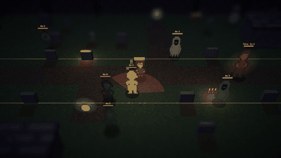
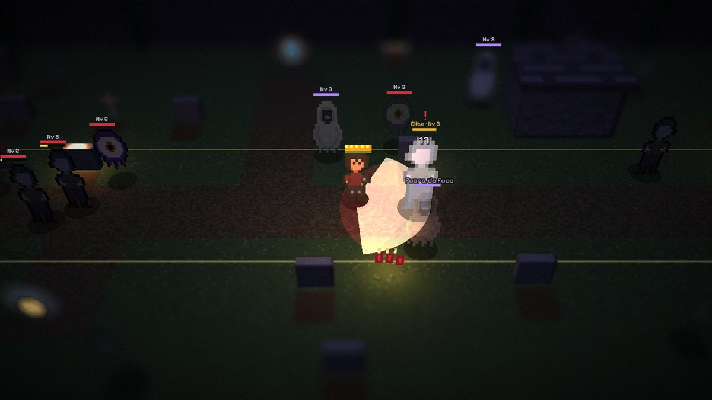
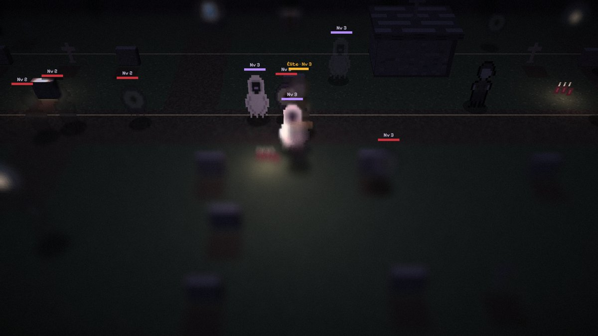
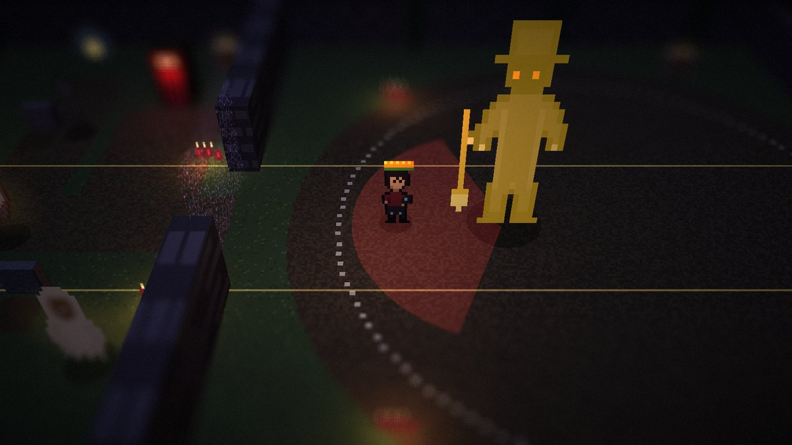
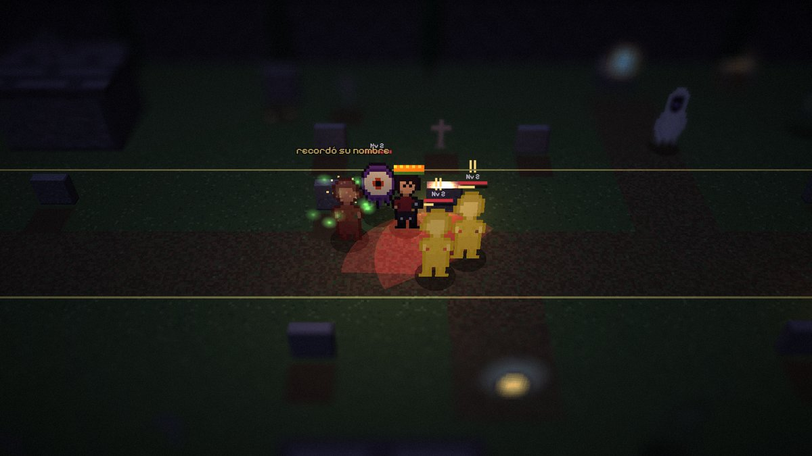

<div align="center">

# 📷 SAN OLVIDO
### *Fuera de Foco*

**"En San Olvido, lo que nadie mira, muere."**

ARPG souls-like oscuro en **2D-HD**: pixel art dentro de un diorama 3D, con vista tipo Diablo.<br>
Tu arma es una cámara antigua, y **solo existe lo que está enfocado**.




</div>

---

## 🕯️ La historia

> **San Olvido, 1920.** Don Aurelio, el fotógrafo del pueblo, retrataba a los muertos para que sus familias nunca los olvidaran. Una noche, en una de sus placas apareció **un ojo que no era de este mundo**.
>
> Desde entonces, ese ojo se lleva todo lo que el pueblo deja de mirar, y los muertos que nadie recuerda regresan **sin rostro**.
>
> Tú eres **Luz**, su hija. Heredaste la cámara. **Lo que enfocas, existe.**

## 🎯 La mecánica: el foco

<table>
<tr>
<td width="50%"></td>
<td width="50%"></td>
</tr>
<tr>
<td><b>Solo hay daño entre lo enfocado.</b> Tú y el enemigo tienen que estar dentro de la franja dorada. Si golpeas algo borroso, sale <i>"fuera de foco"</i>.</td>
<td><b>Mueve la franja</b> (Q/E o la rueda) para decidir con qué grupo pelear. Los <b>Velados</b> solo existen fuera de foco, así que con ellos tienes que desenfocarte.</td>
</tr>
<tr>
<td width="50%"></td>
<td width="50%"></td>
</tr>
<tr>
<td><b>Flash = parry.</b> Cuando el enemigo brilla en <b>dorado</b>, lo sobreexpones y queda aturdido. Con <b>F</b> le tomas una foto y lo ejecutas.</td>
<td><b>Viste a Luz con lo que encuentres.</b> Sombreros, sarapes, botas y milagritos cambian su sprite y sus estadísticas.</td>
</tr>
</table>

## ✨ Qué tiene el prototipo

| | |
|---|---|
| ⚔️ **Combate souls** | Esquiva con invulnerabilidad, parry con flash, ejecución con foto, estamina (luz) y jefe con 2 fases |
| 🔭 **2 lentes** | **Gran angular** (arco amplio, franja ancha) y **Teleobjetivo** (disparos, franja estrecha y crítico en el centro del foco) |
| 👻 **3 enemigos + élites** | **Mirones**, **Olvidados** (puedes *recordarlos* en lugar de matarlos) y **Velados**. Los enemigos van del Nv 1 al 4 según la zona. |
| 💀 **Jefe** | **El Sepulturero Sin Rostro**: palada que se puede parar, golpes de tierra y, a la mitad de su vida, un velo que lo vuelve real solo fuera de foco |
| ❤️ **Progresión estilo Minecraft** | Corazones, orbes de experiencia, niveles y 5 atributos para repartir |
| 👒 **Ropa visible** | 17 objetos en 4 rarezas: común, raro, épico y **legendario** |
| 🧰 **Cofres** | Normales, **velados** (solo existen fuera de foco), uno que muerde y el del jefe |
| 🔍 **5 secretos** | Las notas de Don Aurelio, una tumba muy especial y algo que *nunca se detiene* 🧀 |
| 🌫️ **Estilo souls** | Cuartos oscuros como hogueras. Al morir, tu experiencia se queda en una foto donde caíste. |

## 🎮 Jugar

Abre **`index.html`** en Chrome o Edge (necesitas teclado, mouse e internet para cargar three.js), o sirve la carpeta con:

```bash
python -m http.server 8000
```

y entra a **http://localhost:8000**

| Tecla | Acción |
|---|---|
| `WASD` + mouse | Moverte y apuntar |
| `Clic` | Atacar |
| `Clic derecho` | **Flash** (parry cuando brilla dorado) |
| `Espacio` | Esquiva (te desenfoca un instante) |
| `Q` / `E` · rueda | Mover la franja de foco · `C` para centrarla |
| `F` | Foto a un enemigo aturdido |
| `H` | Veladora (cura) |
| `1` / `2` | Cambiar de lente |
| `R` | Interactuar: cofres, notas, cuarto oscuro |
| `I` | Personaje: ropa, mochila y atributos |

## 🗂️ Contenido del repositorio

| Ruta | Qué es |
|---|---|
| `index.html` | El juego (un solo archivo) |
| [`docs/concepto.md`](docs/concepto.md) | Documento de diseño: historia, lentes, enemigos, mundo y alcance |
| [`docs/playtest.md`](docs/playtest.md) | Reglas, controles y preguntas para probarlo |
| [`docs/concepto-v1-foco.md`](docs/concepto-v1-foco.md) | Concepto original de la mecánica de foco |
| [`prototipos/foco/`](prototipos/foco/) | Primer prototipo: puzzles de foco en el pueblo |

## 🛣️ Lo que sigue

- [ ] **La Mina:** una zona donde la luz importa más que nunca
- [ ] Más lentes: macro, ojo de pez y placa de daguerrotipo
- [ ] Música y sonido ambiental
- [ ] Guardar la partida
- [ ] Vertical slice en Godot 4

---

<div align="center"><sub>Hecho con three.js, pixel art procedural y mucha niebla. 🕯️</sub></div>
